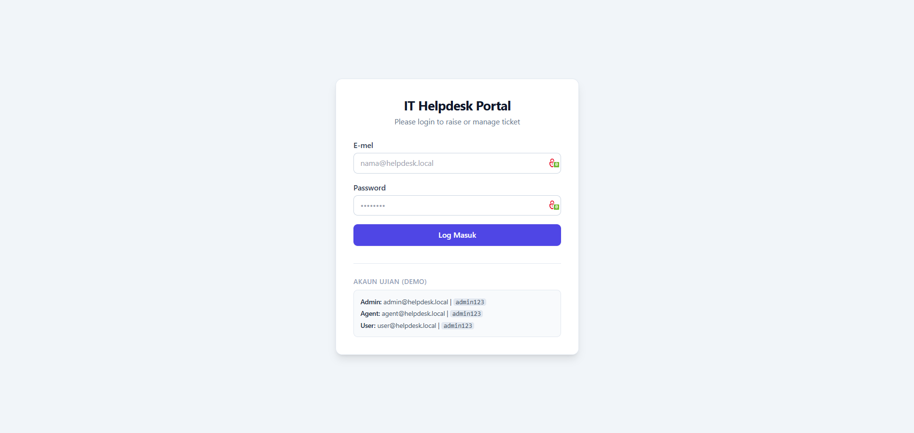
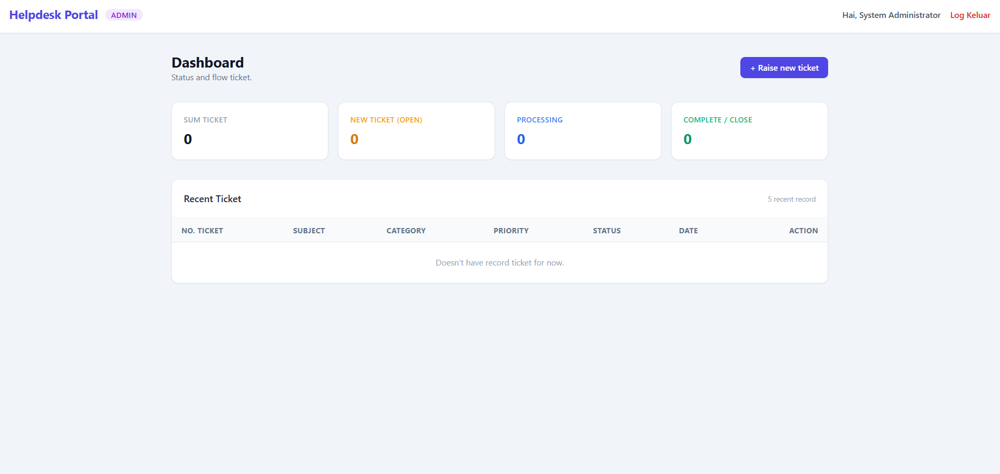
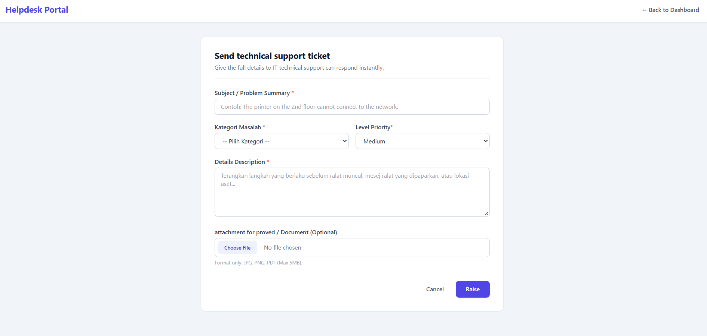

# IT Helpdesk & Ticketing Management System

Sistem pengurusan tiket bantuan teknikal berasaskan web yang dibangunkan menggunakan **PHP (PDO)**, **MySQL**, dan **Tailwind CSS**. Projek ini direka untuk mendemonstrasikan aliran kerja sokongan IT dunia sebenar merangkumi kawalan akses berasaskan peranan (**RBAC**), penjejakan status kitaran hayat tiket, muat naik fail selamat, serta log audit penuh.

---

## Ciri-Ciri Utama

* **Role-Based Access Control (RBAC):**
  * **User (Pengguna):** Menghantar tiket aduan baharu, memuat naik lampiran ralat, melihat perkembangan tiket sendiri, dan menghantar maklum balas.
  * **Agent (Staf IT Support):** Mengambil alih tiket (*Assign to Me*), mengemas kini status penyelesaian, dan menulis **Internal Notes** (nota sulit yang disembunyikan daripada pengguna biasa).
  * **Admin (Pentadbir):** Memantau keseluruhan metrik sistem dan mengurus semua tiket merentasi jabatan.
* **Penjanaan Nombor Rujukan Automatik:** Setiap tiket menerima nombor siri unik berasaskan tarikh dan urutan harian (contoh: `TCK-20261112-001`).
* **Jejak Audit (Audit Trail):** Merekodkan setiap perubahan status, pengambilalihan tiket, dan penghantaran balasan secara kronologi.
* **Paparan Metrik Dinamik:** Papan pemuka (*Dashboard*) menyesuaikan statistik tiket secara automatik mengikut peranan pengguna yang log masuk.

---

## Amalan Keselamatan yang Diterapkan

* **Pencegahan SQL Injection:** Menggunakan sepenuhnya **PDO Prepared Statements** (`ATTR_EMULATE_PREPARES => false`) untuk semua pertanyaan pangkalan data.
* **Pengesahan Sesi & Identiti:** Menggunakan `password_hash()` (Bcrypt), `password_verify()`, dan `session_regenerate_id(true)` bagi mengekang serangan *Session Fixation*.
* **Pengesahan Lampiran Fail Ketat:** Menyemak jenis MIME sebenar menggunakan `finfo_file()` (hanya membenarkan JPG, PNG, PDF di bawah 5MB) serta menamakan semula fail menggunakan rentetan rawak kriptografi (`random_bytes`) untuk mengelakkan serangan *Arbitrary File Upload*.
* **Database Transactions:** Memastikan integriti data antara jadual `tickets`, `ticket_attachments`, dan `ticket_logs` kekal konsisten sekiranya berlaku ralat semasa proses penghantaran.

---

## Pratonton Antaramuka

| Halaman Log Masuk | Papan Pemuka (Dashboard) |
| :---: | :---: |
|  |  |

### Paparan Butiran Tiket & Log Audit


---

## Struktur Direktori Projek

```text
it-ticketing-system/
├── auth/                  # Modul log masuk, pemprosesan sesi, dan log keluar
├── config/                # Konfigurasi sambungan pangkalan data PDO
├── controllers/           # Logik backend (cipta tiket, kemas kini status, balasan)
├── database/
│   └── schema.sql         # Skema jadual MySQL (DDL) & data permulaan (Seeders)
├── docs/
│   └── screenshots/       # Tangkapan skrin antaramuka untuk dokumentasi
├── helpers/               # Fungsi kawalan akses dan pelindung sesi (RBAC Guard)
├── uploads/               # Direktori simpanan lampiran fail pengguna
├── views/                 # Antaramuka pengguna (Dashboard, Borang Tiket, Butiran)
├── .gitignore             # Pengecualian fail sensitif dan direktori tempatan
├── index.php              # Pintu masuk utama aplikasi
└── README.md              # Dokumentasi projek

1. **Klon Repositori**
   ```bash
   git clone [https://github.com/2230285/IT-Ticketing-System.git](https://github.com/2230285/IT-Ticketing-System.git)
   cd IT-Ticketing-System